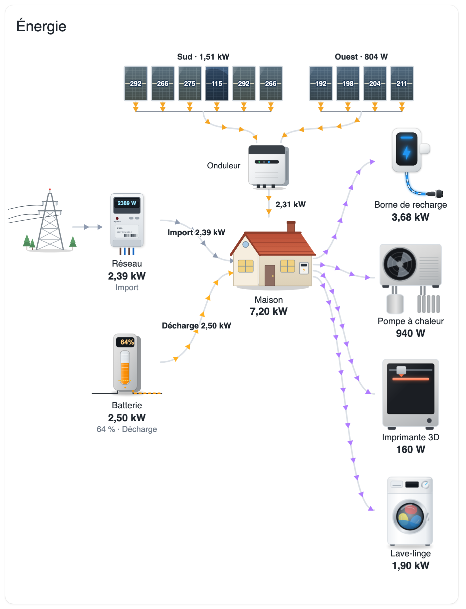
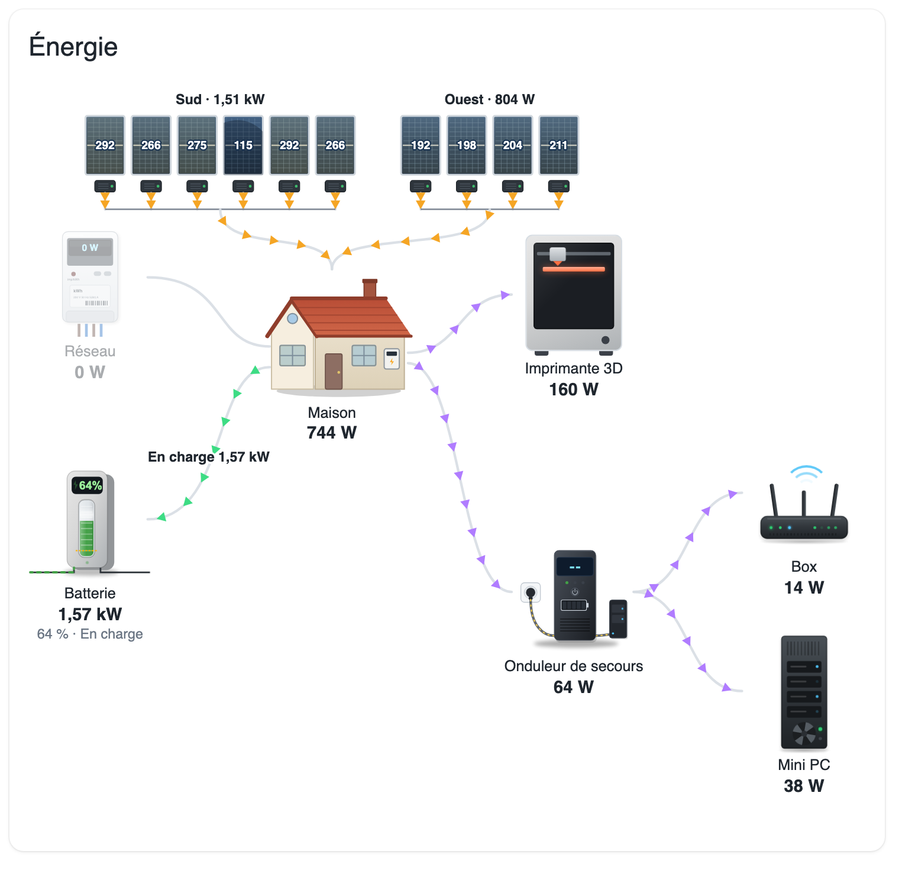

# Illustrated Energy Flow Card

<a href="https://github.com/ADNPolymerase/ha-illustrated-energy-flow-card/blob/main/README.md"></a>

[](https://hacs.xyz/docs/faq/custom_repositories)
[](https://github.com/ADNPolymerase/ha-illustrated-energy-flow-card/releases)
[](https://github.com/ADNPolymerase/ha-illustrated-energy-flow-card/actions/workflows/hacs.yml)
[](https://github.com/ADNPolymerase/ha-illustrated-energy-flow-card/actions/workflows/test.yml)
[](https://github.com/ADNPolymerase/ha-illustrated-energy-flow-card/blob/main/LICENSE)
[](https://buymeacoffee.com/adnpolymerase)

<a href="https://buymeacoffee.com/adnpolymerase" target="_blank"></a>
<a href="https://adnpolymerase.github.io/HA/" target="_blank"></a>

Une carte de flux d'énergie dont les éléments sont des **appareils dessinés et animés** plutôt que des icônes dans des ronds, et qui montre le solaire **panneau par panneau**.

> **Bêta (0.x).** La mise en page et les dessins vont encore évoluer. Vos retours sont les bienvenus dans les issues.



## Fonctionnalités

- **Le solaire panneau par panneau** : chaque panneau a son propre flux vers sa string, à sa propre vitesse, avec ses watts écrits dessus. Un panneau à l'ombre ralentit seul et s'assombrit. Vue par panneau, par string ou en total.
- **Le réseau dans les deux sens** : un capteur signé, ou un capteur d'import et un d'export. Le flux change de sens et de couleur.
- **La batterie** : charge et décharge, avec son niveau sur l'écran de la batterie dessinée.
- **Des consommateurs nommés** : n'importe lequel des 72 dessins de [HA Appliance Card](https://github.com/ADNPolymerase/ha-appliance-card) (lave-linge, imprimante 3D, frigo, box, onduleur...) quand elle est installée, sinon une borne de recharge, une pompe à chaleur, un ballon d'eau chaude ou une prise connectée. Un consommateur peut en alimenter d'autres (un onduleur qui alimente la box et un mini PC).
- **Micro-onduleurs ou optimiseurs** : un petit boîtier sous chaque panneau, et plus d'onduleur central avec des micro-onduleurs.
- **Batterie sur l'onduleur** (onduleurs hybrides, une PowerStream sur sa station) ou sur la maison.
- **Pylône électrique** devant le compteur, en option.
- **La maison est calculée** si vous n'avez pas de capteur de consommation (solaire + réseau + batterie).
- La vitesse des flux suit la puissance ; les branches sans puissance s'estompent.
- Dessins repris de [HA Appliance Card](https://github.com/ADNPolymerase/ha-appliance-card), plus une maison, un onduleur mural et les panneaux.
- 6 langues (EN, FR, DE, ES, IT, NL), éditeur visuel compact (on choisit le nombre de strings et de consommateurs), thèmes clair et sombre.

## Installation

HACS > trois points > **Dépôts personnalisés** > ajouter `https://github.com/ADNPolymerase/ha-illustrated-energy-flow-card` en catégorie **Tableau de bord**, installer, puis recharger le navigateur.

Manuelle : copier `illustrated-energy-flow-card.js` depuis la [dernière release](https://github.com/ADNPolymerase/ha-illustrated-energy-flow-card/releases) dans `config/www/` et ajouter `/local/illustrated-energy-flow-card.js` comme ressource module JavaScript.

## Configuration

```yaml
type: custom:illustrated-energy-flow-card
grid:
  power_entity: sensor.grid_power        # + import, - export
solar:
  strings:
    - name: Sud
      panels:                            # un capteur de puissance par panneau
        - sensor.panel_1_power
        - sensor.panel_2_power
        - entity: sensor.panel_3_power
          name: Toit du garage
    - name: Ouest
      power_entity: sensor.mppt_2_power  # une string sans capteur par panneau
battery:
  power_entity: sensor.battery_power     # + décharge, - charge
  soc_entity: sensor.battery_level
consumers:
  - entity: sensor.ev_charger_power
    type: ev_charger
  - entity: sensor.heat_pump_power
    type: heat_pump
  - entity: sensor.ups_power
    type: ups
    children:                            # alimentés par l'onduleur
      - entity: sensor.router_power
        type: network
        appliance:                       # options de HA Appliance Card
          network_layout: router
```



| Option | Défaut | Description |
|---|---|---|
| `grid.power_entity` | | Puissance réseau signée : positive en import, négative en export |
| `grid.import_entity` / `grid.export_entity` | | À la place : deux capteurs positifs |
| `grid.invert` | `false` | Inverser le signe |
| `grid.meter` | `box` | `box`, `linky` ou `dome` |
| `grid.pylon` | `false` | Dessiner un pylône électrique devant le compteur |
| `solar.strings` | | Liste des strings : `name`, `panels` (entités ou `{entity, name}`), `power_entity` |
| `solar.power_entity` | somme des strings | Puissance solaire totale, affichée sous l'onduleur, ou au-dessus de la maison avec des micro-onduleurs |
| `solar.view` | `panel` | `panel`, `string` ou `total` |
| `solar.microinverters` | `false` | `true` : un micro-onduleur sous chaque panneau, pas d'onduleur central. `string` : un sous chaque string, pour les doubles et quadruples (APsystems DS3, Hoymiles HM-800) |
| `solar.optimizers` | `false` | Un optimiseur sous chaque panneau |
| `inverter.show` | `true` | Dessiner l'onduleur entre les panneaux et la maison |
| `inverter.power_entity` | total solaire | Sortie de l'onduleur |
| `battery.power_entity` | | Puissance batterie signée : positive en décharge, négative en charge |
| `battery.invert` | `false` | Inverser le signe |
| `battery.soc_entity` | | Niveau de charge (%) |
| `battery.reserve` | | Réserve affichée sur la jauge de la batterie (%) |
| `battery.reserve_entity` | | La réserve lue sur un capteur ou une entité number (%), à la place de la valeur fixe |
| `battery.coupling` | `home` | `home`, ou `inverter` pour une batterie côté continu de l'onduleur |
| `home.power_entity` | calculée | Consommation de la maison |
| `consumers` | | Liste : `entity`, `name`, `type`, `appliance`, `children` |
| `consumers[].type` | `generic` | Tout type de HA Appliance Card (`washer`, `printer_3d`, `filament_dryer`, `fridge`, `network`, `ups`...), ou `ev_charger`, `heat_pump`, `water_heater`, `generic` sans elle. `printer` est dessiné par HA Printer Card |
| `consumers[].appliance` | | Options supplémentaires de la carte qui le dessine : HA Appliance Card (`state_entity` pour un dessin qui suit un état marche/arrêt...), ou HA Printer Card pour une `printer` (`entity` pour son capteur d'état, `printer_type`, `state_map`, `printing_watts`). Sans capteur d'état, une imprimante est prête tant que sa prise consomme, et imprime au-delà de 50 W |
| `consumers[].children` | | Consommateurs alimentés par celui-ci (un niveau) |
| `consumers_hide_below` | | Masque les consommateurs qui tirent cette puissance ou moins (W), et ceux indisponibles. Un consommateur qui s'arrête reste deux minutes, celui qui en alimente un autre en marche reste. Vide : tous affichés |
| `consumers_layout` | `auto` | `column`, `columns` (deux colonnes décalées, bien moins haute), `compact` (dessins plus petits et plus serrés), ou `wrap` (deux colonnes, puis la suite en rangées sous le réseau et la maison, là où la carte est vide, le tout alimenté par une seule ligne qui se ramifie : environ deux fois moins haute avec beaucoup de consommateurs). `auto` passe en deux colonnes au-delà de trois consommateurs, une colonne quand un consommateur en alimente d'autres |
| `panel_peak` | `450` | Puissance crête d'un panneau (W), pour la lueur et la vitesse du flux |
| `rated_power` | `6000` | Puissance du flux le plus rapide (W) |
| `style` | `drawn` | `drawn` (dessiné), ou `light` (allégé) : chaque consommateur dessiné à mi-taille, son nom et sa puissance à côté, les consommateurs bien plus serrés. Une colonne jusqu'à huit consommateurs |
| `max_scale` | `1` | Jusqu'où la carte peut grandir au-delà de sa taille, de `0.5` à `1.3` |
| `flow_style` | `arrows` | `arrows` ou `dashes` |
| `animate` | `true` | Animer les flux |
| `dim_inactive` | `true` | Estomper les branches sans puissance |
| `clickable` | `true` | Ouvrir la fiche au clic |
| `decimals` | `0` | Décimales sous le kilowatt |
| `language` | `auto` | `auto`, `en`, `fr`, `de`, `es`, `it`, `nl` |
| `title` | | Titre de la carte |

Chaque `name` est facultatif ; `grid`, `battery` et `home` en acceptent un aussi.

## Capteurs par panneau

Les micro-onduleurs (Enphase, Hoymiles, APsystems...) et les optimiseurs (Tigo, SolarEdge...) exposent en général un capteur de puissance par panneau. Sans eux, donnez à chaque string sa `power_entity` (une entrée MPPT de l'onduleur) : ses panneaux restent dessinés, sans valeur propre.

## Licence

MIT. Les dessins sont des illustrations SVG originales.
