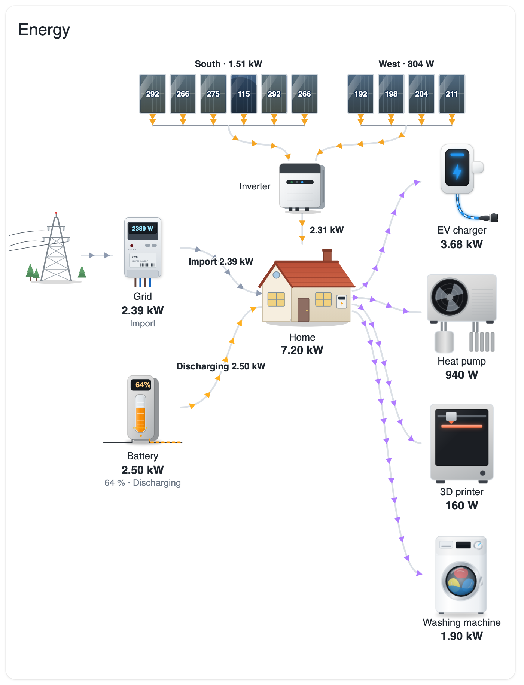
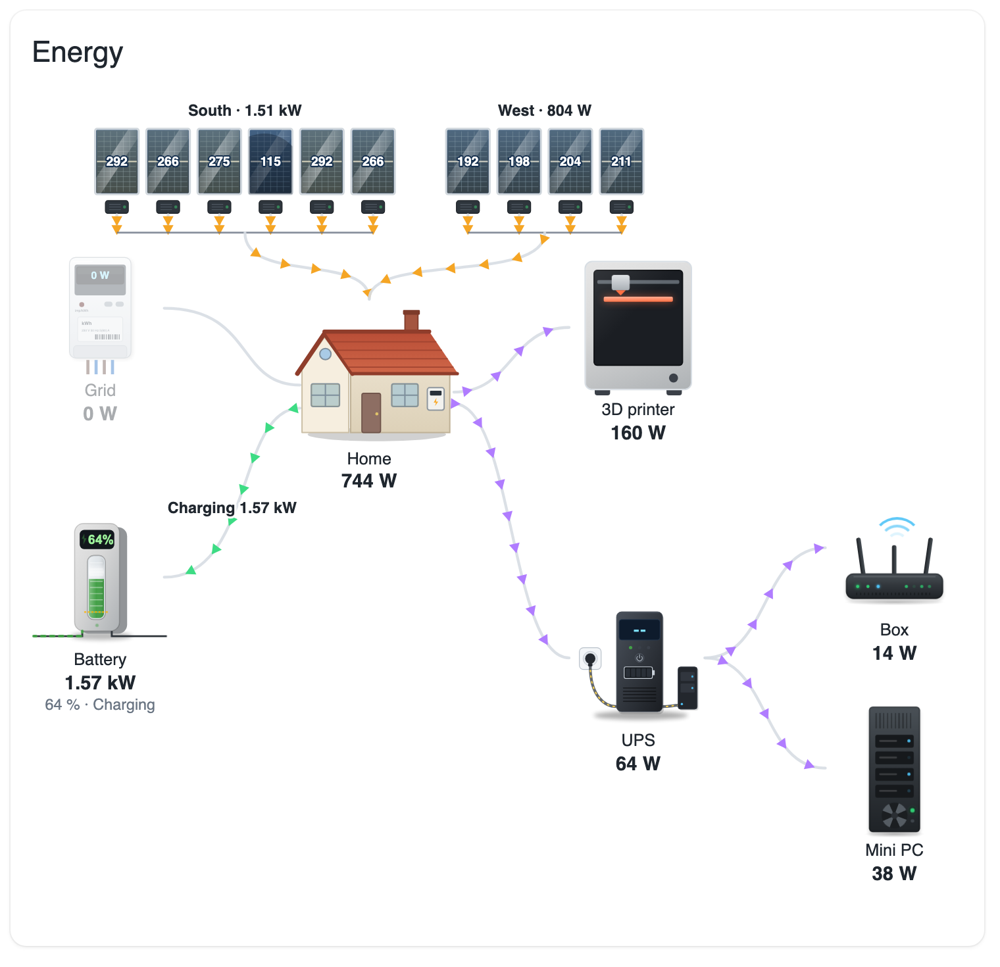

# Illustrated Energy Flow Card

<a href="https://github.com/ADNPolymerase/ha-illustrated-energy-flow-card/blob/main/README.fr.md"></a>

[](https://hacs.xyz/docs/faq/custom_repositories)
[](https://github.com/ADNPolymerase/ha-illustrated-energy-flow-card/releases)
[](https://github.com/ADNPolymerase/ha-illustrated-energy-flow-card/actions/workflows/hacs.yml)
[](https://github.com/ADNPolymerase/ha-illustrated-energy-flow-card/actions/workflows/test.yml)
[](https://github.com/ADNPolymerase/ha-illustrated-energy-flow-card/blob/main/LICENSE)
[](https://buymeacoffee.com/adnpolymerase)

<a href="https://buymeacoffee.com/adnpolymerase" target="_blank"></a>
<a href="https://adnpolymerase.github.io/HA/" target="_blank"></a>

An energy flow card whose nodes are **drawn, animated devices** instead of icons in circles, and which shows the solar side **panel by panel**.

> **Beta (0.x).** The layout and the drawings will still change. Feedback is welcome in the issues.



## Features

- **Solar panel by panel**: each panel has its own flow to its string, at its own speed, with its watts written on it. A shaded panel slows down on its own and darkens. Panel, string or total view.
- **Two-way grid**: one signed sensor, or an import and an export sensor. The flow changes direction and colour.
- **Home battery**: charge and discharge, with its level on the drawn battery's screen.
- **Named consumers**: any of the 72 drawings of [HA Appliance Card](https://github.com/ADNPolymerase/ha-appliance-card) (washing machine, 3D printer, fridge, router, UPS...) when it is installed, otherwise an EV charger, a heat pump, a water heater or a smart plug. A consumer can feed others (a UPS feeding the router and a mini PC).
- **Microinverters or optimisers**: a small box under each panel, and no central inverter with microinverters.
- **Battery on the inverter** (hybrid inverters, a PowerStream on its station) or on the home.
- **Utility pylon** in front of the meter, optional.
- **The home is computed** when you have no consumption sensor (solar + grid + battery).
- The flow speed follows the power; branches without power fade out.
- Drawings from [HA Appliance Card](https://github.com/ADNPolymerase/ha-appliance-card), plus a new house, a wall string inverter and the panels.
- 6 languages (EN, FR, DE, ES, IT, NL), compact visual editor (choose how many strings and consumers), light and dark themes.

## Installation

HACS > three dots > **Custom repositories** > add `https://github.com/ADNPolymerase/ha-illustrated-energy-flow-card` as **Dashboard**, install, then reload the browser.

Manual: copy `illustrated-energy-flow-card.js` from the [latest release](https://github.com/ADNPolymerase/ha-illustrated-energy-flow-card/releases) into `config/www/` and add `/local/illustrated-energy-flow-card.js` as a JavaScript module resource.

## Configuration

```yaml
type: custom:illustrated-energy-flow-card
grid:
  power_entity: sensor.grid_power        # + import, - export
solar:
  strings:
    - name: South
      panels:                            # one power sensor per panel
        - sensor.panel_1_power
        - sensor.panel_2_power
        - entity: sensor.panel_3_power
          name: Garage roof
    - name: West
      power_entity: sensor.mppt_2_power  # a string without per-panel sensors
battery:
  power_entity: sensor.battery_power     # + discharge, - charge
  soc_entity: sensor.battery_level
consumers:
  - entity: sensor.ev_charger_power
    type: ev_charger
  - entity: sensor.heat_pump_power
    type: heat_pump
  - entity: sensor.ups_power
    type: ups
    children:                            # fed by the UPS
      - entity: sensor.router_power
        type: network
        appliance:                       # HA Appliance Card options
          network_layout: router
```



| Option | Default | Description |
|---|---|---|
| `grid.power_entity` | | Grid power, signed: positive imports, negative exports |
| `grid.import_entity` / `grid.export_entity` | | Instead: two positive sensors |
| `grid.invert` | `false` | Invert the sign |
| `grid.meter` | `box` | `box`, `linky` or `dome` |
| `grid.pylon` | `false` | Draw a utility pylon in front of the meter |
| `solar.strings` | | List of strings: `name`, `panels` (entity ids or `{entity, name}`), `power_entity` |
| `solar.power_entity` | sum of strings | Total solar power |
| `solar.view` | `panel` | `panel`, `string` or `total` |
| `solar.microinverters` | `false` | One microinverter under each panel, no central inverter |
| `solar.optimizers` | `false` | One optimiser under each panel |
| `inverter.show` | `true` | Draw the inverter between the panels and the home |
| `inverter.power_entity` | solar total | Inverter output |
| `battery.power_entity` | | Battery power, signed: positive discharges, negative charges |
| `battery.invert` | `false` | Invert the sign |
| `battery.soc_entity` | | State of charge (%) |
| `battery.reserve` | | Reserve shown on the battery's gauge (%) |
| `battery.coupling` | `home` | `home`, or `inverter` for a battery on the inverter's DC side |
| `home.power_entity` | computed | Home consumption |
| `consumers` | | List: `entity`, `name`, `type`, `appliance`, `children` |
| `consumers[].type` | `generic` | Any HA Appliance Card type (`washer`, `printer_3d`, `fridge`, `network`, `ups`...), or `ev_charger`, `heat_pump`, `water_heater`, `generic` without it |
| `consumers[].appliance` | | Extra HA Appliance Card options for the drawing |
| `consumers[].children` | | Consumers fed by this one (one level) |
| `panel_peak` | `450` | Peak power of one panel (W), for the glow and the flow speed |
| `rated_power` | `6000` | Power of the fastest flow (W) |
| `flow_style` | `arrows` | `arrows` or `dashes` |
| `animate` | `true` | Animate the flows |
| `dim_inactive` | `true` | Fade the branches without power |
| `clickable` | `true` | Open more-info on click |
| `decimals` | `0` | Decimals below a kilowatt |
| `language` | `auto` | `auto`, `en`, `fr`, `de`, `es`, `it`, `nl` |
| `title` | | Card title |

Every `name` is optional; `grid`, `battery` and `home` also take one.

## Sensors per panel

Microinverters (Enphase, Hoymiles, APsystems...) and optimisers (Tigo, SolarEdge...) usually expose one power sensor per panel. Without them, give each string its `power_entity` (one MPPT input of the inverter): its panels are still drawn, without a value of their own.

## License

MIT. The drawings are original SVG illustrations.
